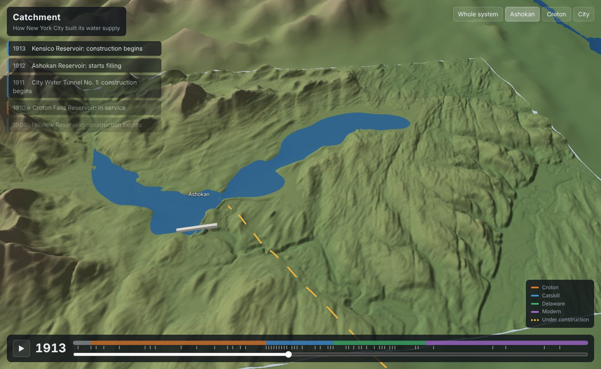
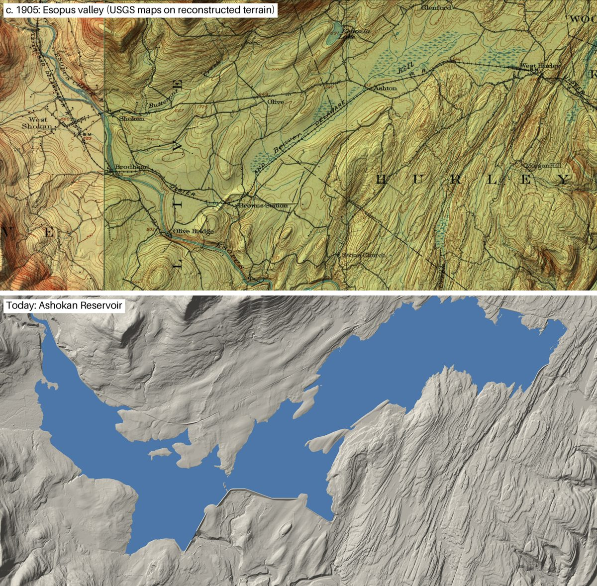
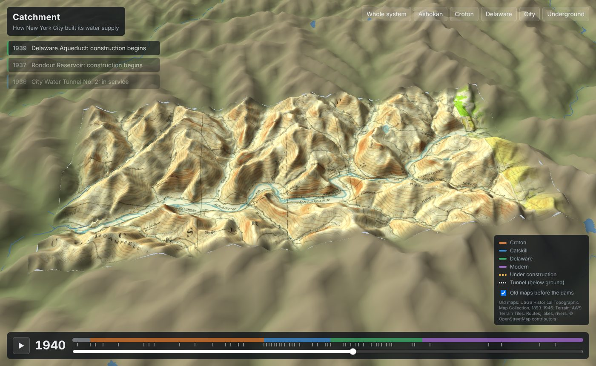
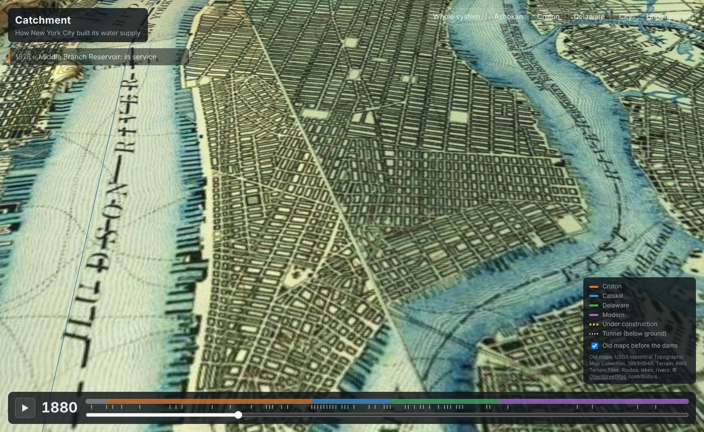

# Catchment

A 3D, scrubbable history of New York City's water supply: reservoirs, dams, aqueducts and tunnels, from the Croton system of the 1830s to the Delaware Aqueduct bypass, rendered for the web.

Plan: [NYC Water History in 3D](https://claude.ai/artifact/7ar4CxqWiGdjeNMVFFmz3P). The MVP covers the whole system at low fidelity, with the Ashokan valley reconstructed in detail.

## Run the 3D scene

```sh
cd web
npm install
npm run dev        # then open the printed localhost URL
```

Drag the time bar or press play to watch 1830 to 2030. The buttons at the top right fly to the whole system, Ashokan, the Croton watershed, the Delaware valleys, or the city; **Underground** turns the ground see-through to follow the tunnels. Every rebuilt valley also has its own view (`view=pepacton`, `cannonsville`, `neversink`, `rondout`, `schoharie`, `kensico`, `new-croton`). The URL keeps the year and view, so `?t=1913&view=ashokan` opens on Ashokan filling. Add `q=low` for a lighter mesh on slow machines, or `q=high` for full mesh detail in the valleys.

`pipeline/export_web.py` writes the scene's data into `web/public/data/`: Terrarium-encoded heightmaps (kept to 0.25 m), a reservoir-outline mask found from flat water surfaces, and for each rebuilt valley its pre-reservoir ground (`<id>_pre.png`), reservoir footprint (`_mask.png`), dam heights (`_dam.png`) and old-map texture (`_topo.jpg`), plus `scene.json`.

`pipeline/osm_water.py` adds what comes from OpenStreetMap (raw extracts in `data/osm/`): `water_mask.png`, the region's natural lakes, ponds, rivers and other towns' reservoirs (NYC's own are left to the timeline), `rivers.json` (the same rivers as lines), and `routes.json`, the real aqueduct and tunnel routes split into cut-and-cover runs (drawn on the ground) and rock tunnels (drawn 120 m underground with shafts at the portals, and dotted where seen through the terrain). Data © OpenStreetMap contributors, ODbL.



## Status: phase 1 (data spike)

| Path | What it is | Source |
| --- | --- | --- |
| `pipeline/terrain.py` | Fetches elevation tiles for a bounding box, writes a 16-bit heightmap, metadata and a hillshade preview | [AWS Terrain Tiles](https://registry.opendata.aws/terrain-tiles/) (mostly USGS 3DEP here) |
| `pipeline/nid_dams.py` → `data/dams.geojson` | The 24 dams owned by NYC DEP: location, height, length, year completed | [National Inventory of Dams](https://nid.sec.usace.army.mil/) |
| `pipeline/build_timeline.py` → `data/timeline.json` | 33 features (reservoirs, aqueducts, tunnels) and 84 dated events | Wikipedia articles cited per feature, plus NID |
| `data/aqueducts.geojson` | **Schematic** aqueduct and tunnel routes, hand-placed waypoints | Approximate, to be replaced by OpenStreetMap geometry |
| `pipeline/preview_map.py` → `docs/alignment_check.png` | Everything drawn over the regional hillshade to check that it lines up | |

### Known gaps

- Years flagged `approx` in `timeline.json` are inferred and need checking against primary sources.
- Aqueduct routes come from OpenStreetMap except City Water Tunnels 1-3, the Delaware bypass and High Bridge, which are still schematic. Tunnel depths are a fixed 120 m, not surveyed.
- Spillway elevations are missing for the smaller Croton reservoirs.
- Only Ashokan's drowned valley follows the surveyed creeks; the other seven are synthetic (see below).
- Boyds Corner (1872) and Middle Branch (1878) are older than any USGS survey, so the 1890s maps already show them as lakes.

## Phase 2 (in progress): Ashokan before the dam

`pipeline/ashokan_predam.py` rebuilds the Esopus valley under Ashokan Reservoir as it was before filling began in 1912. It masks the reservoir's flat surface in modern terrain, removes the Olive Bridge Dam, and drops the old Esopus Creek and Beaver Kill (hand-traced from the 1903 and 1905 USGS sheets into `data/ashokan_thalwegs.geojson`) to their old beds. It then fills the basin between those creeks and the shoreline. The deepest point comes out at 57 m below today's water level; the published maximum depth is 190 ft (58 m).



`pipeline/compare_contours.py` draws the reconstruction's 20 ft contours (magenta) over the old maps to check it against the survey: [docs/ashokan_contour_check.jpg](docs/ashokan_contour_check.jpg).

Limits: the valley floor between the creeks is interpolated, not surveyed, so small hills and terraces under the water are missing. Which way the Beaver Kill flowed in the east basin is uncertain (both ends are lower than Ashton in the middle).

## Phase 3 (in progress): every big valley before its reservoir

`pipeline/old_maps.py` asks The National Map for the historical USGS sheets over each valley and keeps, per quadrangle, the latest edition printed before filling (1:24,000 where one exists, else 1:31,680 or 1:62,500). For New Croton it stops at 1900, because the 1902 Tarrytown sheet already prints the planned reservoir.

| Valley | Sheets |
| --- | --- |
| New Croton | Tarrytown 1893, Carmel 1894, West Point 1899, Stamford 1899 |
| Kensico | Tarrytown 1902, Stamford 1899 (these show the small 1885 Kensico reservoir) |
| Schoharie | Gilboa 1903 |
| Rondout | Lackawack 1942 (1:24,000), Neversink 1944, Slide Mountain 1905 |
| Neversink | Neversink 1944 |
| Pepacton | Arena 1946, Margaretville 1946, Andes 1924, Margaretville 1904 |
| Cannonsville | Deposit 1944, Walton 1925 |

`pipeline/valley.py <id>` then fetches terrain at zoom 14 (about 7 m), warps the sheets onto it (clipped to their neatlines), finds the reservoir from its flat surface, and builds a pre-dam floor. Unlike Ashokan's, that floor is **synthetic**: depth grows with distance from the shore and toward the dam, scaled to the published maximum depth (or 85% of the dam's height). It has the right volume and overall shape, not the real river bed; tracing each valley's old river from its maps, as for Ashokan, would fix that.



In the scene each valley's dam rises out of the ground and the water climbs from the old floor to today's level.

**Map editions.** `pipeline/map_editions.py` builds a stack of dated map composites for each patch (Ashokan, the seven valleys and the city): for each year window, the latest sheet of every quadrangle printed in it. Pre-reservoir editions are shown before the dam; the first edition printed after it comes in once the reservoir is full, and later ones (into the 1990s) take over from the year they were printed, so a patch is never left as bare terrain. The scene loads each edition only when its years come near and frees the rest.

### Also in the scene

- **The old Croton River and Croton Lake.** `data/thalwegs/new-croton.geojson` is the river traced from the 1893–1899 sheets, with elevations anchored at the two dams. `valley.py` builds New Croton's floor from it (as for Ashokan) and finds the 1842 Croton Lake as the floor below its level (49 m) upstream of the Old Croton Dam. The lake appears in 1842 and goes under New Croton in 1905–06. Muscoot, East Branch, Bog Brook and Diverting are in the timeline too.
- **Dams.** Each dam is built along its crest line from OpenStreetMap (`data/osm/dams.json`), down to the ground without it, with a cross-section by its NID type: a stone gravity wall for masonry and concrete dams, an embankment with riprap and grass for earth dams (`web/src/dams.ts`). They rise during construction.
- **Sea, Sound and Hudson.** `osm_water.py` floods the sea from OpenStreetMap's coastline (`data/osm/coastline.json`) and adds the tidal Hudson above Yonkers from the flat, near-sea-level ground along its centreline.
- **Reservoir shores.** Where OpenStreetMap maps a reservoir, its polygon replaces the 28 m outline found in the terrain. The Manhattan reservoirs that are gone are footprints in `data/city_reservoirs.geojson` (Yorkville Receiving and Murray Hill from a Manhattan street-grid model; the Central Park Reservoir from OSM).
- **What the water is for.** On the Croton Distributing Reservoir's footprint (Fifth Avenue at 41st Street) a blue column holds one day of the city's water use, at the terrain's height exaggeration, beside an outline of what the system could dependably deliver that year, with the population above (`web/src/demand.ts`). The column turns red as use nears supply. Use and supply figures are rounded approximations for now.
- **Catchments.** `pipeline/catchments.py` fills the region heightmap's pits, takes each cell's D8 flow direction and drainage area, and labels every cell with the first NYC reservoir its water reaches (`flow.png`, `catchments.json`). The computed watersheds come within about 5% of DEP's published ones (Ashokan 674 km² vs 257 mi², Cannonsville 1,206 km² vs 454 mi², the Croton system 1,013 km² vs 375 mi²). The scene tints each catchment by system once its reservoir exists (before that, its ground counts toward the next reservoir downstream), outlines the divides and draws streams draining more than ~5 km². Tapping the ground traces everything upstream of that point, or the whole catchment of a reservoir, with its area and the rain that falls on it.
- **Droughts.** In 1949–50, the 1960s, 1980–81, 1985 and 2001–02 every full reservoir draws down together to the system's low (≈ 25–55% full; rounded approximations), the water planes sink and the bare bed shows as mud; the city's column notes the drought (`storage()` in `web/src/demand.ts`).
- **The city.** A ~7 m patch over Manhattan, Brooklyn and the Bronx with USGS editions from 1891, 1900, 1947, 1966 and 1995 (`valley.py city`, `map_editions.py`).



## Regenerating the data

```sh
pip install numpy pillow
curl -o nid.csv https://nid.sec.usace.army.mil/api/nation/csv
python pipeline/nid_dams.py nid.csv data/dams.geojson
python pipeline/build_timeline.py
python pipeline/terrain.py region 12 -75.55 40.5 -73.45 42.45 out/terrain out/tiles   # ~28 m/px, ~775 tiles
python pipeline/terrain.py ashokan 14 -74.33 41.90 -74.04 42.02 out/terrain out/tiles # ~7 m/px
python pipeline/preview_map.py out/terrain docs/alignment_check.png
# pre-dam Ashokan: put NY_Slide Mountain_148515_1905_62500_geo.tif and NY_Rosendale_148354_1903_62500_geo.tif
# (USGS topoView / prd-tnm.s3.amazonaws.com/StagedProducts/Maps/HistoricalTopo/GeoTIFF/NY/) in out/topo
pip install rasterio scipy
python pipeline/ashokan_predam.py out/terrain out/topo
python pipeline/compare_contours.py out/terrain out/ashokan_contour_check.png
python pipeline/render_before_after.py out/terrain out/ashokan_before_after.png
# the other valleys (scans ~250 MB in out/oldmaps)
python pipeline/old_maps.py out/oldmaps
for v in new-croton kensico schoharie rondout neversink pepacton cannonsville city; do
  python pipeline/valley.py $v out/terrain out/oldmaps out/tiles
done
python pipeline/map_editions.py out/terrain out/oldmaps   # dated editions (~1 GB more scans)
# web data (scene.json first, then the OpenStreetMap layers, which read it)
python pipeline/export_web.py out/terrain web/public/data
python pipeline/osm_water.py web/public/data --terrain out/terrain
python pipeline/catchments.py web/public/data   # flow directions and catchments (~1 min)
python pipeline/check_scene.py out/terrain        # automatic artifact checks
```

Terrain outputs (about 90 MB) are not committed.
